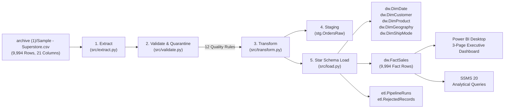

# Enterprise Automated ETL Data Pipeline & Interactive BI Analytics Platform

[](https://www.python.org/)
[](https://www.microsoft.com/sql-server/)
[](https://learn.microsoft.com/sql/ssms/)
[](https://powerbi.microsoft.com/)
[](https://pytest.org/)

---

## 1. Project Overview

The **Enterprise Automated ETL Data Pipeline & Interactive BI Analytics Platform** is a professional university DBMS capstone project. It ingests, validates, standardizes, stages, warehouses, and visualizes retail transaction records using the **Sample Superstore** dataset.

The system implements a production-grade data engineering pipeline following the **Kimball Dimensional Modeling** methodology with a multi-layered Star Schema hosted on **Microsoft SQL Server Express (`.\SQLEXPRESS`)**, orchestrated by a modular **Python 3.12 ETL framework**, and exposed to executive stakeholders through an interactive **Power BI Desktop** analytics platform.

---

## 2. Architecture & Data Flow



---

## 3. Technology Stack

- **Data Processing & ETL:** Python 3.12.10, Pandas 3.0.6, NumPy 2.5.3
- **Database Engine:** Microsoft SQL Server 2025 Express Edition (64-bit)
- **Database Connectivity:** PyODBC 5.3.0, Microsoft ODBC Driver 18 for SQL Server
- **Database Management & Querying:** SQL Server Management Studio (SSMS) 20
- **Data Quality & Testing:** Pytest 9.1.1 (12 automated unit and integration tests)
- **Interactive Business Analytics:** Microsoft Power BI Desktop
- **Source Control:** Git 2.55

---

## 4. Repository Structure

```
.
├── archive (1)/
│   └── Sample - Superstore.csv      # Source CSV (Preserved intact: 9,994 rows, 21 cols)
├── docs/
│   ├── architecture.md              # Detailed technical architecture & pipeline design
│   ├── star_schema_erd.md           # Star Schema ERD, grains, measures, and keys
│   ├── data_dictionary.md           # Complete SQL data dictionary across all 3 schemas
│   ├── data_quality_rules.md        # 12 automated data quality & quarantine rules
│   ├── ssms_demonstration_guide.md  # University instructor SSMS 20 presentation guide
│   ├── power_bi_guide.md            # Power BI connection steps, DAX formulas & visuals
│   └── troubleshooting_guide.md     # Common configuration and connection remedies
├── sql/
│   ├── 01_create_database.sql       # Safe idempotent creation of AnalyticsDW
│   ├── 02_create_schemas.sql        # Creates stg, dw, and etl schemas
│   ├── 03_create_staging.sql        # Creates stg.OrdersRaw table
│   ├── 04_create_dimensions.sql     # Creates DimDate, DimCustomer, DimProduct, DimGeo, DimShip
│   ├── 05_create_fact.sql           # Creates dw.FactSales with foreign keys
│   ├── 06_create_audit.sql          # Creates etl.PipelineRuns and etl.RejectedRecords
│   ├── 07_create_indexes_constraints.sql # Creates non-clustered performance indexes
│   ├── 08_validation_queries.sql    # Orphan checks, row counts, temporal checks
│   ├── 09_analytical_queries.sql    # Executive KPIs, category & monthly queries
│   └── 10_reconciliation.sql       # 100% financial reconciliation query
├── src/
│   ├── __init__.py
│   ├── config.py                    # Environment variables, connection strings, logging
│   ├── extract.py                   # Ingestion, Windows-1252 decoding, header checks
│   ├── validate.py                  # Domain checks, date validation, duplicate quarantine
│   ├── transform.py                 # ZIP padding, date keys YYYYMMDD, cost & margin math
│   ├── load.py                      # Staging load, surrogate key resolution, fact bulk insert
│   ├── audit.py                     # Execution telemetry & quarantine logging
│   └── main.py                      # CLI pipeline orchestrator & reconciliation runner
├── tests/
│   ├── __init__.py
│   ├── conftest.py                  # Shared test fixtures & mock anomalous records
│   ├── test_extract.py              # Unit tests for CSV ingestion & headers
│   ├── test_validate.py             # Unit tests for data quality & quarantine
│   ├── test_transform.py            # Unit tests for normalization & metric calculations
│   └── test_load.py                 # Integration tests for SQL Server & referential integrity
├── logs/
│   └── pipeline.log                 # Detailed timestamped execution logs
├── .env.example                     # Sample environment variable template
├── .gitignore                       # Standard Python, SQL, and data gitignore
├── requirements.txt                 # Exact package versions
└── README.md                        # Master project documentation
```

---

## 5. Quickstart & Execution Guide

### Step 1: Environment Setup
Clone the repository and install the dependencies:
```powershell
pip install -r requirements.txt
```
Copy `.env.example` to `.env` (configured for local Windows Authentication by default):
```powershell
Copy-Item .env.example .env
```

### Step 2: Database Initialization
Execute the SQL DDL scripts to create the `AnalyticsDW` database, schemas, tables, and indexes in SQL Server:
```powershell
sqlcmd -S .\SQLEXPRESS -E -i "sql\01_create_database.sql"
sqlcmd -S .\SQLEXPRESS -E -i "sql\02_create_schemas.sql"
sqlcmd -S .\SQLEXPRESS -E -i "sql\03_create_staging.sql"
sqlcmd -S .\SQLEXPRESS -E -i "sql\04_create_dimensions.sql"
sqlcmd -S .\SQLEXPRESS -E -i "sql\05_create_fact.sql"
sqlcmd -S .\SQLEXPRESS -E -i "sql\06_create_audit.sql"
sqlcmd -S .\SQLEXPRESS -E -i "sql\07_create_indexes_constraints.sql"
```

### Step 3: Run the Automated ETL Pipeline
Execute the Python pipeline from the project root:
```powershell
python -m src.main
```

### Step 4: Run Automated Tests
Execute the full test suite with pytest:
```powershell
python -m pytest -v
```

---

## 6. Financial & Metric Reconciliation Results

Upon pipeline execution, the warehouse reconciles **100%** against the source dataset benchmarks:

| Metric Name | Expected Source Benchmark | Actual Loaded Warehouse | Variance | Reconciliation Status |
| :--- | :---: | :---: | :---: | :---: |
| **Transaction Rows** | `9,994` | `9,994` | `0.0000` | **PASSED** |
| **Distinct Orders** | `5,009` | `5,009` | `0.0000` | **PASSED** |
| **Distinct Customers** | `793` | `793` | `0.0000` | **PASSED** |
| **Total Units Sold** | `37,873` | `37,873` | `0.0000` | **PASSED** |
| **Total Sales Revenue** | `$2,297,200.8603` | `$2,297,200.8603` | `0.0000` | **PASSED** |
| **Total Net Profit** | `$286,397.0217` | `$286,397.0217` | `0.0000` | **PASSED** |

---

## 7. Interactive BI Dashboards (Power BI Desktop & Web Analytics)

The warehouse features dual visualization integration:

### Option A: Interactive Web Analytics Platform (Streamlit + Plotly)
A full-stack, real-time BI dashboard connected live to SQL Server:
```powershell
streamlit run src/dashboard.py
```
Open **[http://localhost:8501](http://localhost:8501)** to access:
- **Executive Overview:** Real-time KPI cards ($2.30M Sales, $286.4K Profit, 12.5% Margin, 5,009 Orders, $458.61 AOV), 48-month dual-axis revenue/margin trend, customer segment donut chart, and regional sales vs profit bars.
- **Product & Sales Analysis:** Treemap of Categories & Sub-Categories, Top 10 Profitable Products, Loss-Making Products diagnostic table, and Discount Sensitivity scatter plot.
- **Customer Analytics:** Top 10 Customers by Revenue, Segment Revenue/Profit comparison, and State-level ranking.
- **Global Slicers:** Dynamic Year, Region, and Segment filters.

### Option B: Microsoft Power BI Desktop
The warehouse connects natively to Power BI Desktop via `.\SQLEXPRESS` (`AnalyticsDW`).

- **Power BI Desktop Download:** [Download from Microsoft Store](ms-windows-store://pdp/?productid=9NTM2QC6QWS7) or [Direct Installer](https://aka.ms/pbiSingleInstaller).
- **Detailed Setup & DAX Guide:** Refer to [`docs/power_bi_guide.md`](docs/power_bi_guide.md) for step-by-step connection instructions, active/inactive relationship configuration, and pre-validated DAX measures:
  - `Total Sales`, `Total Profit`, `Profit Margin %`, `Total Orders`, `Average Order Value`, `YoY Sales Growth %`, `Sales YTD`.

---

## 8. University Instructor Demonstration Guide

For the presentation to your university instructor, follow the detailed walkthrough in [`docs/ssms_demonstration_guide.md`](docs/ssms_demonstration_guide.md):
- Open **SSMS 20** and expand `AnalyticsDW`.
- Inspect the Star Schema tables, data types (`DECIMAL(12,4)`, zero-padded `VARCHAR(5)` postal codes), foreign keys, and indexes.
- Execute `sql/08_validation_queries.sql` showing **0 orphan foreign keys** and **0 invalid sequences**.
- Execute `sql/09_analytical_queries.sql` showing real-time SQL analytical aggregation.
- Execute `sql/10_reconciliation.sql` showing **zero financial variance**.
- Show `etl.PipelineRuns` demonstrating run telemetry and idempotent re-run resilience.

---

## 9. Author & GitHub Profile

- **Developer:** [SamiSiddiqui45](https://github.com/SamiSiddiqui45)
- **Repository:** [Enterprise Automated ETL Data Pipeline & Interactive BI Analytics Platform](https://github.com/SamiSiddiqui45/Enterprise-Automated-ETL-Data-Pipeline-BI-Analytics-Platform)
- **Academic Context:** University DBMS & Data Warehousing Capstone Project.

