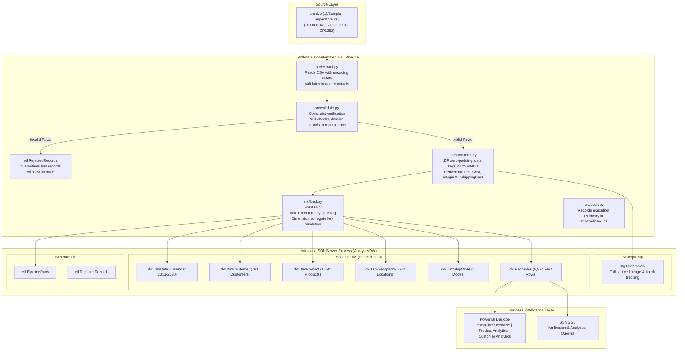

# System Architecture & Technical Design

## 1. Executive Summary

The **Enterprise Automated ETL Data Pipeline & Interactive BI Analytics Platform** is a multi-tier data platform engineered to ingest, clean, validate, transform, warehouse, and visualize enterprise retail transaction data.

The system is built on Microsoft SQL Server 2025 Express, Python 3.12, Pandas, PyODBC, and Power BI Desktop.

---

## 2. End-to-End Pipeline Architecture

---

## 3. Layered Design Principles

### 3.1 Raw Source Layer
- **Source:** `archive (1)/Sample - Superstore.csv`.
- **Character Encoding:** Windows-1252 (`cp1252`), preserving non-breaking spaces and Windows typographic symbols.
- **Rule of Non-Destruction:** Raw source files are read-only and never modified or deleted.

### 3.2 Staging Layer (`stg`)
- **Table:** `stg.OrdersRaw`.
- Retains 100% of the raw source attributes as strings/raw representations.
- Appends operational metadata: `ETLRunID` and `IngestionTimestamp` for end-to-end data lineage.
- Staging records can be reloaded across multiple runs without affecting warehouse consistency.

### 3.3 Dimensional Warehouse Layer (`dw`)
- Implemented as a **Star Schema** centered on `dw.FactSales`.
- Dimensions use integer surrogate primary keys (`IDENTITY(1,1)`).
- Natural keys (`CustomerID`, `ProductID`, `PostalCode`) are preserved.
- Temporal attributes are connected via integer surrogate keys (`YYYYMMDD`) to `dw.DimDate`.

### 3.4 Audit & Quarantine Layer (`etl`)
- **`etl.PipelineRuns`**: Tracks run status (`RUNNING`, `SUCCESS`, `FAILED`), timestamps, runtime durations, and row counts across all pipeline stages.
- **`etl.RejectedRecords`**: Quarantines any invalid rows with exact failure reasons, column names, offending values, and the complete raw row serialized as JSON.

---

## 4. Key Architectural Decisions

1. **Surrogate Key Strategy for Product Dimension:**
   - Profiling revealed that 32 `Product ID` codes have minor naming variations across the 4-year span.
   - To preserve 100% of historical product names and avoid dropping or overwriting data, `dw.DimProduct` models unique `(ProductID, ProductName, Category, SubCategory)` tuples (1,894 unique rows) with surrogate key `ProductKey`.
2. **Postal Code Normalization:**
   - Raw postal codes stored as integers drop leading zeros (e.g. `1040`).
   - The transformation pipeline normalizes postal codes to 5-digit zero-padded strings (`01040`) stored as `VARCHAR(5)`.
3. **Idempotency & Re-run Safety:**
   - `dw.FactSales` enforces a unique constraint on `SourceRowID`.
   - Repeated pipeline runs insert new batches into staging while skipping already-loaded transactions in the fact table, guaranteeing that reruns never introduce duplicate transactions.
4. **Financial Arithmetic Precision:**
   - All monetary fields (`SalesAmount`, `ProfitAmount`, `CalculatedCost`) use `DECIMAL(12, 4)`.
   - All discount rates use `DECIMAL(5, 4)`.
   - Floating-point accumulation errors are eliminated.
