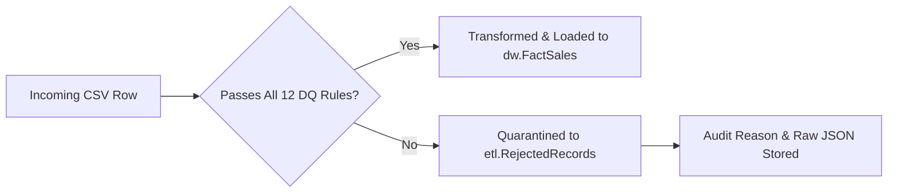

# Data Quality Rules & Quarantine Governance

## 1. Quality Governance Philosophy

In enterprise ETL engineering, data quality must be proactive, deterministic, and auditable. Bad records should **never be silently deleted or ignored**. Instead, invalid data must be quarantined with full lineage and diagnostic telemetry.

---

## 2. Core Validation Rules

The pipeline enforces five categories of automated checks in `src/validate.py`:

### 2.1 Mandatory Business Key Completeness
- **Rule ID:** `DQ-01`
- **Scope:** `Row ID`, `Order ID`, `Customer ID`, `Product ID`, `Order Date`, `Ship Date`.
- **Constraint:** Must not be `NULL`, `NaN`, empty string, or whitespace-only.
- **Action on Violation:** Record is quarantined to `etl.RejectedRecords` with reason `NULL_OR_EMPTY_<COLUMN>`.

### 2.2 Numeric Integrity & Domain Constraints
- **Rule ID:** `DQ-02 (Row ID)`: Must be an integer strictly > 0.
- **Rule ID:** `DQ-03 (Sales Amount)`: Must be numeric float >= 0.0. Negative sales are rejected.
- **Rule ID:** `DQ-04 (Quantity)`: Must be an integer strictly > 0. Zero or negative purchase quantities are rejected.
- **Rule ID:** `DQ-05 (Discount Rate)`: Must be numeric float within closed interval `[0.0, 1.0]`. Discounts outside 0% to 100% are rejected.
- **Rule ID:** `DQ-06 (Profit Amount)`: Must be a valid float. Negative values are permitted (representing discount-driven net losses).

### 2.3 Temporal Sequencing & Calendar Rules
- **Rule ID:** `DQ-07 (Date Format)`: Both `Order Date` and `Ship Date` must parse strictly to format `M/D/YYYY`.
- **Rule ID:** `DQ-08 (Temporal Ordering)`: `Ship Date` must be greater than or equal to `Order Date` (`ShipDate >= OrderDate`). If `ShipDate < OrderDate`, row is quarantined with reason `SHIP_DATE_PRECEDES_ORDER_DATE`.

### 2.4 Uniqueness & Idempotency Rules
- **Rule ID:** `DQ-09 (Source Row ID Uniqueness)`: In any input batch, each `Row ID` must appear exactly once. Multiple occurrences of the same `Row ID` in the source file are flagged with reason `DUPLICATE_SOURCE_ROW_ID`.
- **Rule ID:** `DQ-10 (Warehouse Fact Idempotency)`: If a `SourceRowID` already exists in `dw.FactSales`, the pipeline preserves existing records without inserting duplicate rows.

### 2.5 Normalization & Formatting Rules
- **Rule ID:** `DQ-11 (Postal Code Normalization)`: US postal codes are formatted as 5-character zero-padded strings (`VARCHAR(5)`). E.g. raw integer `1040` -> normalized string `'01040'`.
- **Rule ID:** `DQ-12 (Whitespace Standardization)`: All text fields are stripped of leading and trailing whitespace.

---

## 3. Quarantine Workflow

When a record fails validation:
1. It is removed from the active transform/load candidate pool.
2. A structured rejection dictionary is constructed containing:
   - `SourceRowID`
   - `OrderID`
   - `RejectionReason`
   - `RejectedColumn`
   - `RejectedValue`
   - `RawRecordJSON` (full serialized raw record)
3. The record is batch-inserted into `etl.RejectedRecords`.
4. The execution count in `etl.PipelineRuns[RejectedRowCount]` is incremented.
5. The pipeline continues safely for all valid rows without crashing.
