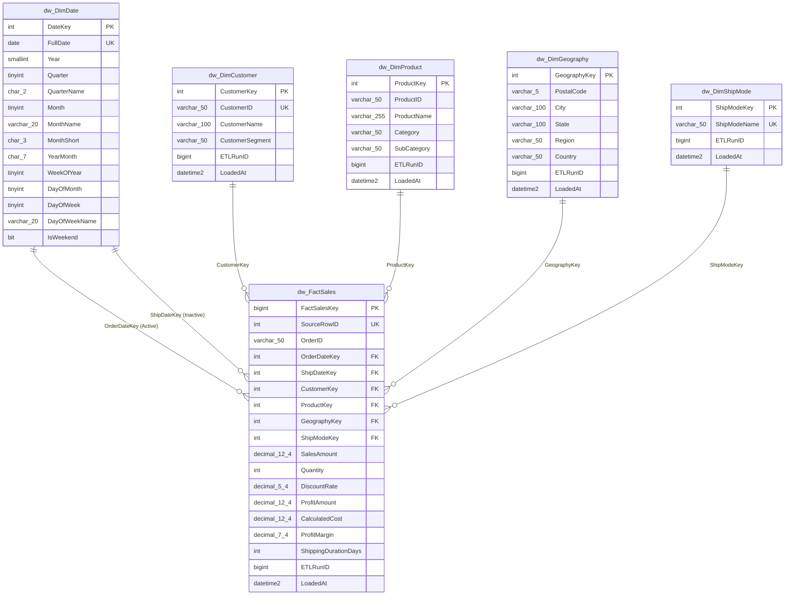

# Star Schema Design & Entity-Relationship Documentation

## 1. Dimensional Model Overview

The data warehouse schema (`dw`) follows a classic Kimball Star Schema dimensional modeling architecture. It centers around a single atomic line-item transaction fact table (`dw.FactSales`) surrounded by five conformed dimension tables.

---

## 2. Entity-Relationship Diagram (ERD)

---

## 3. Fact Table Specification

### `dw.FactSales`
- **Business Concept:** Individual sales line item.
- **Grain:** One record per source transaction line (`Row ID`).
- **Primary Key:** `FactSalesKey` (`BIGINT IDENTITY(1,1)`).
- **Unique Constraint:** `SourceRowID` (prevents duplication on pipeline reruns).
- **Foreign Keys:**
  - `OrderDateKey` -> `dw.DimDate(DateKey)` (Active relationship in Power BI)
  - `ShipDateKey` -> `dw.DimDate(DateKey)` (Inactive role-playing relationship)
  - `CustomerKey` -> `dw.DimCustomer(CustomerKey)`
  - `ProductKey` -> `dw.DimProduct(ProductKey)`
  - `GeographyKey` -> `dw.DimGeography(GeographyKey)`
  - `ShipModeKey` -> `dw.DimShipMode(ShipModeKey)`
- **Additive Measures:**
  - `SalesAmount` (`DECIMAL(12,4)`): Gross sales revenue before discount.
  - `Quantity` (`INT`): Units sold.
  - `ProfitAmount` (`DECIMAL(12,4)`): Net profit earned.
  - `CalculatedCost` (`DECIMAL(12,4)`): `SalesAmount - ProfitAmount`.
- **Non-Additive & Semi-Additive Measures:**
  - `DiscountRate` (`DECIMAL(5,4)`): Discount percentage (0.0 to 0.8).
  - `ProfitMargin` (`DECIMAL(7,4)`): Safe margin ratio (`ProfitAmount / NULLIF(SalesAmount, 0)`).
  - `ShippingDurationDays` (`INT`): Elapsed days between order placement and shipment.

---

## 4. Dimension Tables Specification

### 4.1 `dw.DimDate`
- **Records:** 2,922 continuous calendar dates spanning 2013-01-01 through 2020-12-31.
- **Key:** `DateKey` (Integer in `YYYYMMDD` format).
- **Role-Playing Capability:** Supports both order placement analysis and delivery duration analysis without schema duplication.

### 4.2 `dw.DimCustomer`
- **Records:** 793 distinct customer accounts.
- **Surrogate Key:** `CustomerKey` (`INT IDENTITY(1,1)`).
- **Natural Key:** `CustomerID` (`VARCHAR(50) UNIQUE`).
- **Attributes:** `CustomerName`, `CustomerSegment` (`Consumer`, `Corporate`, `Home Office`).

### 4.3 `dw.DimProduct`
- **Records:** 1,894 unique combinations.
- **Surrogate Key:** `ProductKey` (`INT IDENTITY(1,1)`).
- **Natural Key:** `ProductID` (`VARCHAR(50)`).
- **Attributes:** `ProductName`, `Category` (3 unique), `SubCategory` (17 unique).
- **Composite Unique Constraint:** `(ProductID, ProductName, Category, SubCategory)` ensures deterministic resolution while preserving all naming history.

### 4.4 `dw.DimGeography`
- **Records:** 632 unique geographic entities.
- **Surrogate Key:** `GeographyKey` (`INT IDENTITY(1,1)`).
- **Attributes:** `PostalCode` (`VARCHAR(5)` zero-padded), `City`, `State`, `Region`, `Country`.
- **Composite Unique Constraint:** `(PostalCode, City, State, Country)`.

### 4.5 `dw.DimShipMode`
- **Records:** 4 fulfillment channels.
- **Surrogate Key:** `ShipModeKey` (`INT IDENTITY(1,1)`).
- **Attributes:** `ShipModeName` (`Standard Class`, `Second Class`, `First Class`, `Same Day`).
